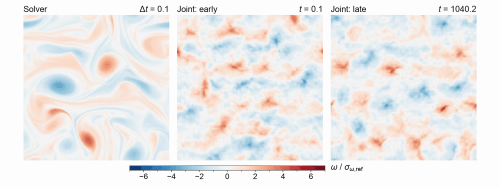
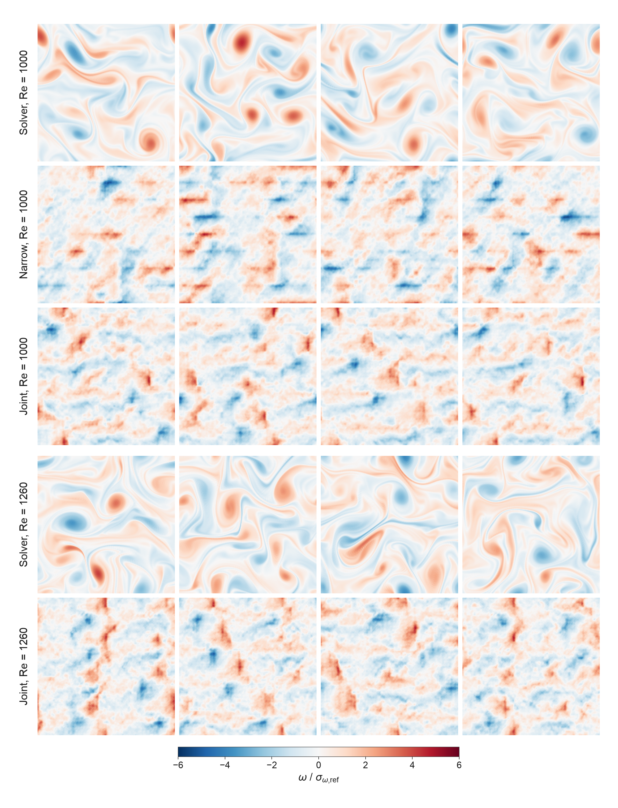
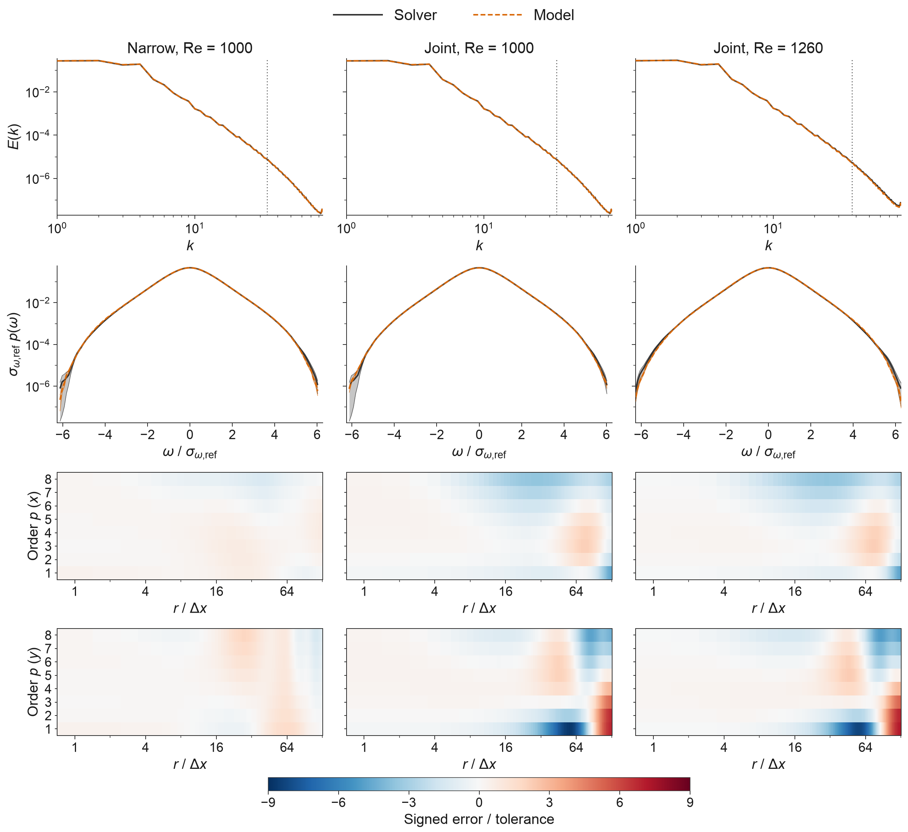
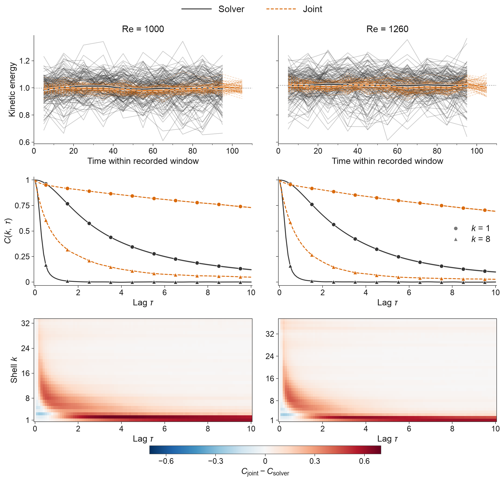

# One-step turbulence

Two-dimensional Kolmogorov turbulence is chaotic fluid motion in a flat box whose opposite edges join, driven by a steady force in alternating bands. Our reference is a pseudo-spectral solver: it represents the flow as Fourier waves and advances it through many small time steps, making independent samples slow to collect because successive states remain correlated. A one-step generator instead produces a whole flow field in one neural-network pass. We tested these generators against the solver and found that close statistical agreement can still hide missing coherent vortices and filaments.

[](figures/flow-re1260.mp4)

[Watch the flow comparison](figures/flow-re1260.mp4): the solver beside the joint model at the start and after about 1,000 turnover times, at Re = 1260. Both model clips are patchy and grainy, without the solver's coherent vortices and filaments.

The narrow model has an estimated 5,360× lower GPU cost at equal statistical precision. The wider joint model stays bounded for about 1,000 turnover times at a Reynolds number it never trained on. Evaluating learned turbulence and one-step physics generators needs tests of spatial structure too.

## What the statistics miss

Both networks produce full 256 × 256 velocity fields directly from noise, with no tokenizer, pretrained compressor or denoising loop. The supplied examples show why their statistical agreement needs a separate check of spatial structure:



The generated examples lack the solver's coherent vortices and filaments; narrow samples also show axis-aligned streaks. All twenty [source fields](data/fields/) appear in stored order on a shared colour scale, divided by the matching solver's rms vorticity.

This is a visual finding in the supplied fields. The compared statistics constrain spectra, vorticity values and velocity differences, but do not directly test vortex shape or arrangement.

## How close the statistics are

The narrow model is within a few tolerance units on the spectrum, velocity-increment moments and vorticity density down to 10⁻³ of the reference peak; errors grow in the rarest tails. The wider joint model generates both samples and trajectories, trained at Re = 1000 and 1580. Its sample errors at untrained Re = 1260 are comparable to those at 1000, with a larger spectral error:

| Worst error, in tolerance units | Narrow samples, 1000 | Joint samples, 1000 | Joint samples, 1260 |
| :--- | ---: | ---: | ---: |
| Energy spectrum | 3.44 | 3.6 | 4.8 |
| Structure functions, orders 1 to 8 | 1.92 | 8.7 | 8.3 |
| Signed third order | 3.27 | 1.6 | 1.9 |
| Vorticity PDF, down to 10⁻³ of peak | 2.56 | 0.75 | 3.00 |
| Vorticity PDF, down to 10⁻⁶ of peak | 14.2 | 16.3 | 15.0 |

One means the chosen error tolerance; lower is better. [Tolerances, sample counts and uncertainty](REPRODUCE.md#what-is-measured).



Curves compare spectra and vorticity densities; heatmaps show signed structure-function errors along both axes. Bands show ±1 standard error, too narrow to see on the spectra at this size; [figure details](figures/) explain the scales and dotted lines.

## Bounded rollouts do not settle it

At each of Re = 1000 and 1260, **64 joint-model trajectories ran for about 1,000 turnover times without blowing up**. In the final measured window, spectral errors are **4.9 / 9.5 tolerance units** and structure-function errors **12.4 / 13.5**. Worst correlation errors are **0.68 / 0.62 absolute**, against a tolerance of 0.02.



Thin energy curves show each member's block averages, thick curves show the average over members, and dotted lines show the solver's reference mean. The model's energy varies less and its correlations persist longer than the solver's; [figure details](figures/) define the time windows and bands.

Architecture timings suggest **7.4× lower cost per simulated time for the joint width**, or **14.8× for the narrow width**. [Timing evidence and assumptions](data/benchmarks/).

## The cost of matching statistical precision

The narrow model draws a field in **65.3 µs** at the best measured batched throughput on an RTX 5070 Ti. Its estimated saving grows when the comparison includes rarer vorticity values:

| Lowest reference density / peak | 10⁻³ | 10⁻⁴ | 10⁻⁵ | 10⁻⁶ |
| :--- | ---: | ---: | ---: | ---: |
| Estimated solver / narrow-model cost | 376× | 1,199× | 2,952× | 5,360× |

These estimates compare the cost of reducing uncertainty in the measured statistics. They do not price recovery of the missing coherent structures. [Calculation and assumptions](REPRODUCE.md#cost-estimates).

## What this does not show

- Equal physical accuracy: the 5,360× figure extrapolates statistical uncertainty, excludes training cost and is sensitive to rare events and correlated reference data.
- Realistic field structure: the supplied generated fields miss coherent vortices and filaments, and the joint model makes the strongest vortices too weak. The compared statistics do not directly test their shape or arrangement.
- Accurate long-time dynamics: bounded energy accompanies too little energy variation, errors above tolerance and correlations that persist too long.
- An independent final test: Re = 1260 helped select variants; Re = 2000 and the joint model at its training value 1580 remain unmeasured.
- A measured 7.4× speedup of the shipped joint weights: timings omit two model features and assume an estimated solver step; the 14.8× narrow-width estimate has no trajectory-accuracy result.

[Full scope and qualifications](REPRODUCE.md#development-scope).

## How to use it

Install the [requirements](requirements.txt), then load the joint weights from the repository root:

```python
import torch
from turb.gensample import load_generator

device = "cuda" if torch.cuda.is_available() else "cpu"
net, cfg = load_generator("weights/joint.pt", device)
with torch.no_grad():
    z = torch.randn(net.noise_shape(1, cfg["n"]), device=device)
    u_hat = net(z, re=1260.0)
    velocity = net.phys(u_hat)
    z = torch.randn_like(z)
    next_hat = net(z, re=1260.0, cond=u_hat)
```

`velocity` has shape `(batch, 2, 256, 256)`; `next_hat` advances the model by 0.1 time units. Use the weights and supplied fields to test what statistical comparisons miss, and include spatial structure when evaluating a generator. The [package guide](turb/) covers the solver and training; [REPRODUCE.md](REPRODUCE.md) explains how to check every headline, regenerate the hero and rerun the measurements. Another forcing requires new solver data and training. Code, weights, data, text and figures are free to use under [CC0 1.0](LICENSE).
