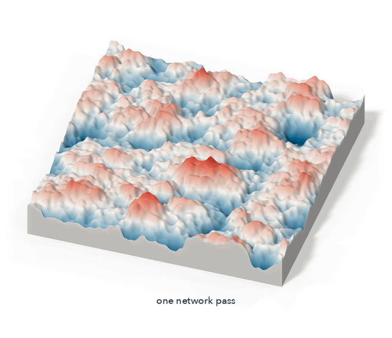
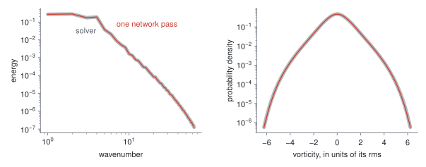
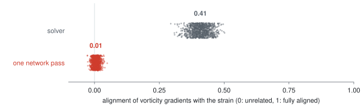
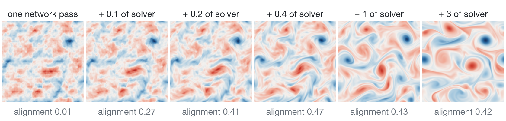
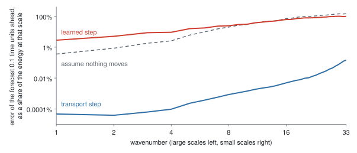
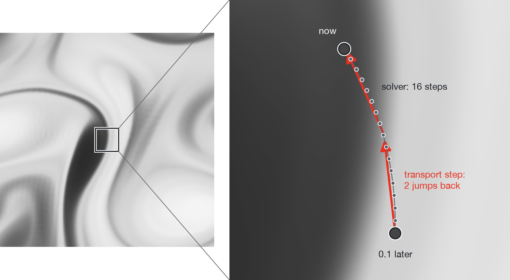
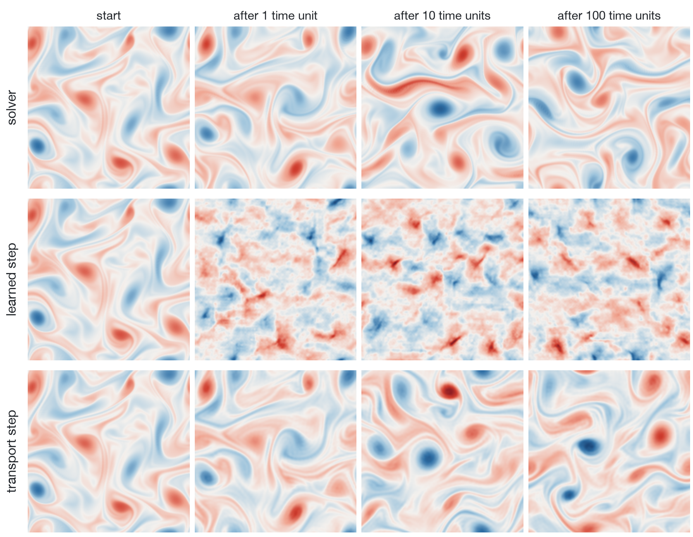

# One network pass matches turbulence's statistics. The vortices are missing.

<p align="center">
  <picture>
    <source media="(prefers-color-scheme: dark)" srcset="figures/handoff-dark.gif">
    
  </picture>
</p>

**One evaluation of a small network (1 NFE) turns noise into a field of two-dimensional Kolmogorov turbulence. Its energy spectrum is off by at most 1.5% at every scale down to the dissipation scale and its vorticity distribution by under 5% down to 1/10,000 of the peak, at an estimated 2,300× lower GPU cost than the pseudo-spectral solver. The vortices and filaments of real turbulence are missing.**

What one network pass makes, then handed to the solver. Height and colour are vorticity, the local spin of the fluid. By every statistic the network was trained on, the first frame is already turbulence. It is not: in a fifth of a time unit the equations draw it into the filaments and vortices it never had. Here is the number that tells the two apart, the reason it comes out that way, and the repair where one exists: for stepping in time, carry the vorticity along the flow. With no network in it, that passes a 1,000-turnover test the learned step fails 32-fold.

## The statistics match

<picture>
  <source media="(prefers-color-scheme: dark)" srcset="figures/statistics-dark.svg">
  
</picture>

16,384 samples, one network pass each, against 3.9 million turnover times of solver that trained nothing:

| | Worst error | Tolerance |
| --- | --- | --- |
| Energy spectrum, every scale down to the dissipation scale | 1.5% | 1% |
| Vorticity distribution, down to 1/10,000 of its peak | 2.8% | 5% |
| Velocity differences across every distance, powers 1 to 8 | 1.8% to 16% | 1% to 8% |
| Their signed cube | 2.7% | 3% |

With the code here, on a Tesla T4, a field takes 470 µs of GPU time. The solver takes 46 ms per turnover time, and its rare events decorrelate so slowly that one independent sample of them costs it over 20 turnover times. At equal precision on these statistics that is the estimated 2,300×. Training is not counted. Compiled, in half precision, the network takes 65 µs a field where the solver takes 10 ms per turnover time, and the ratio is 3,700×. [How the estimate is made.](docs/evidence.md#cost)

## The field does not

<picture>
  <source media="(prefers-color-scheme: dark)" srcset="figures/alignment-dark.svg">
  
</picture>

Vortices shear the fluid between them and draw its vorticity out into filaments, so the steepest change in vorticity turns to face the squeeze. That is how turbulence hands spin down from large scales to small. Alignment measures it: 1 if every gradient faces the squeeze, 0 if gradient and squeeze ignore each other.

The solver: 0.41. The network: 0.01. Over 1,024 fields each, the solver's lowest is 0.29 and the network's highest 0.05. The network's fields have the vorticity of turbulence and the arrangement of noise ([one beside a solver field](figures/pair-light.png)). Nothing it was trained on can see that. It was trained on the scoreboard and it got the scoreboard.

<picture>
  <source media="(prefers-color-scheme: dark)" srcset="figures/handoff-strip-dark.png">
  
</picture>

Hand a sample to the solver and the equations rebuild the filaments in 0.2 time units. They also reject it: the energy climbs 10% above where it started and takes 7.5 time units to come back. Solver fields handed over the same way stay put, within 2%. A sample is not a state of the flow, and repairing one with the solver costs about as much solver time as a fresh solver field. The 2,300× buys the statistics and nothing else.

## What was missing: transport

<picture>
  <source media="(prefers-color-scheme: dark)" srcset="figures/forecast-dark.svg">
  
</picture>

The same failure shows in time. A network trained to advance the flow 0.1 time units per pass runs for 1,000 turnover times without blowing up, and it never learned to move anything. Its forecast of the next field is 3 times worse than assuming nothing moves, 8 times at the largest scale. It matched the statistics of one step by adding noise. Start it from real turbulence and the vortices are gone within one time unit.

What it never found is one of the oldest facts about a fluid: vorticity rides with the flow.

<picture>
  <source media="(prefers-color-scheme: dark)" srcset="figures/transport-dark.png">
  
</picture>

So build it in. To know the vorticity at a point 0.1 time units from now, find where that fluid is now and copy what it carries. Two such jumps per step, with friction, viscosity and forcing applied by exact formulas between them. Nothing is learned. The solver takes 16 steps to cross the same interval.

<picture>
  <source media="(prefers-color-scheme: dark)" srcset="figures/steps-dark.png">
  
</picture>

After one time unit the transport step still matches the solver vortex for vortex. Then chaos separates them, and what must hold is the statistics. 1,000 turnover times of rollout, scored against the solver in tolerances (1 or less is a pass):

| | Learned step | Transport step | Transport step + network |
| --- | --- | --- | --- |
| Memory: each scale's correlation with its past | 32 | 0.63 | 0.69 |
| Velocity differences, powers 1 to 8 | 12 | 0.36 | 0.33 |
| Their signed cube | 2.1 | 0.37 | 0.85 |
| Energy spectrum | 3.5 | 2.5 | 0.49 |
| Vorticity distribution, to 1/1,000 of its peak | 0.63 | 0.67 | 1.4 |
| Alignment (solver on the same band: 0.36) | 0.01 | 0.35 | 0.35 |

The step with nothing learned in it passes where the trained network fails 32-fold. Its one miss is the spectrum: 2.5% too much energy at the smallest scale compared. A small network on top, trained to copy how the solver's statistics respond to one step, takes that out and tips the tail of the vorticity distribution over its tolerance instead. Compiled, that pair runs 14 times cheaper than the solver per simulated time on one GPU; the plain code here, 3.4 times.

## The catch

- **The one-pass sampler is not repaired.** Transport fixes stepping. A network that makes a field from noise in one pass and passes the alignment and hand-off tests is still to be found. The sampler here is trained by matching statistics. It is not a [Mean Flow](https://arxiv.org/abs/2505.13447), and whether a one-step model trained on the whole distribution passes is the obvious next question. The tests are in this repository.
- **The transport step is textbook numerics, not machine learning.** It is a semi-Lagrangian scheme, [the kind weather models have run for decades](<https://doi.org/10.1175/1520-0493(1991)119%3C2206:SLISFA%3E2.0.CO;2>), and it evaluates the equations' own advection term. It is the baseline a learned step has to beat, and [most published comparisons use a weaker one](https://doi.org/10.1038/s42256-024-00897-5). Here the network on top mends 2.5% of the spectrum at the smallest scales and nothing else.
- **Extremes.** Both transport steps make the strongest vortices too common: 9% and 15% too many points at 5 times the rms vorticity.
- **One flow.** Two-dimensional Kolmogorov flow at Reynolds number 1000 on a 256 × 256 grid. No other Reynolds number and no three-dimensional flow is claimed.
- **The costs are estimates** from timings on single GPUs and from standard errors extrapolated to the precision needed.

[Every measurement, how it was made and what was not measured.](docs/evidence.md) [The networks, their training and the transport step.](docs/method.md)

## Run it

```
pip install -r requirements.txt
python reproduce.py            # every number above from data/, in seconds
python -m pytest tests         # the code against known facts, the data against the code
```

```python
from turb.network import load

net = load("sampler")                              # or "learned-step", "transport-step"
u = net(net.noise(4), 1000.0)                      # four fields from noise, one pass each
velocity, vorticity = net.fields(u)

step = load("transport-step")
u = step(step.noise(4), 1000.0, cond=u)            # the same fields 0.1 time units later
```

Each result has its script in [`scripts/`](scripts).

## Cite

```bibtex
@misc{bogdan2026onestepturbulence,
  author = {Bogdan, Philipp},
  title  = {One network pass matches turbulence's statistics. The vortices are missing},
  year   = {2026},
  url    = {https://github.com/philippbogdan/one-step-turbulence}
}
```

Public domain, [CC0 1.0](LICENSE). Take it. Cite it if it helped.
